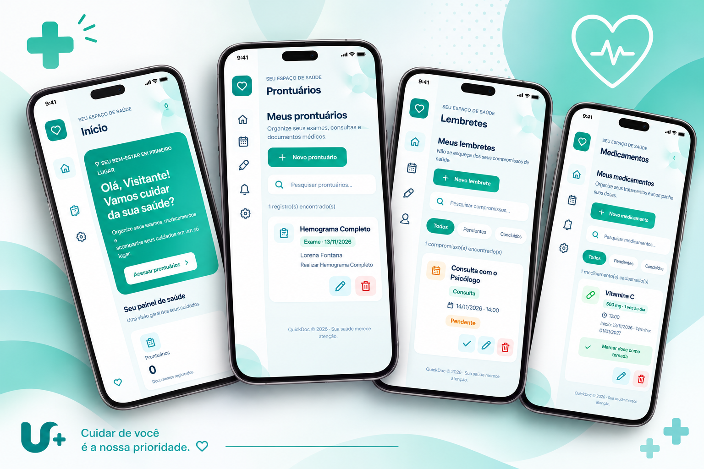

# 💙 QuickDoc — Saúde e Cuidado

<p align="center">
  <strong> Sua saúde merece atenção!</strong>
</p>

<p align="center">
  Aplicativo mobile desenvolvido para facilitar a organização de informações pessoais de saúde, medicamentos, prontuários médicos e lembretes.
</p>

---

## 📱 Sobre o projeto

O **QuickDoc** é um aplicativo de saúde pessoal que permite reunir informações importantes do dia a dia em um único ambiente.

Com uma interface intuitiva, moderna e responsiva, o aplicativo busca facilitar o acompanhamento dos cuidados pessoais e a organização da rotina de saúde.

## ✨ Funcionalidades

- 🏠 **Início:** painel com visão geral dos cuidados.
- 📋 **Prontuários:** cadastro, pesquisa, edição e exclusão de registros médicos.
- 💊 **Medicamentos:** cadastro de medicamentos, horários, dosagens e controle manual de doses.
- 🔔 **Lembretes:** criação, edição, pesquisa e conclusão de compromissos de saúde.
- 👤 **Meu perfil:** gerenciamento das informações pessoais.
- 💾 **Armazenamento local:** persistência dos dados no navegador por meio do LocalStorage.

## 🖼️ Telas do aplicativo

### 🏠 Prontuários médicos

Organização de exames, consultas e documentos médicos.



### 💊 Medicamentos

Acompanhamento de medicamentos, dosagens e horários.


### 🔔 Lembretes

Organização de consultas e compromissos de saúde.


---

## 🎨 Identidade visual

- **Nome:** QuickDoc
- **Segmento:** Saúde e bem-estar.
- **Cor principal:** Azul-turquesa.
- **Cores complementares:** Branco e azul-claro.
- **Símbolo:** Coração, representando cuidado e saúde.
- **Estilo:** Moderno, minimalista e intuitivo.

## 🛠️ Tecnologias utilizadas

| Tecnologia | Aplicação |
|---|---|
| React | Construção da interface |
| JavaScript | Lógica e funcionalidades |
| Vite | Ambiente de desenvolvimento |
| CSS | Estilização |
| Lucide React | Ícones |
| Capacitor | Integração com Android |
| Android | Plataforma mobile |

## 🚀 Como executar o projeto

### 1. Clonar o repositório

```bash
git clone https://github.com/SEU-USUARIO/QuickDoc.git
```

### 2. Entrar na pasta

```bash
cd QuickDoc
```

### 3. Instalar as dependências

```bash
npm install
```

### 4. Executar o projeto

```bash
npm run dev
```

O Vite fornecerá o endereço local para acessar o aplicativo no navegador.

## 📲 Aplicativo Android

O projeto utiliza Capacitor para integrar a aplicação React ao ambiente Android.

Para gerar a versão de produção:

```bash
npm run build
```

Sincronizar os arquivos com o Android:

```bash
npx cap sync android
```

Abrir no Android Studio:

```bash
npx cap open android
```

## ⚙️ Automação de build

O projeto possui integração com GitHub Actions para automatizar a compilação do aplicativo Android.

Arquivo de configuração:

`.github/workflows/android-build.yml`

Após uma execução bem-sucedida, o APK fica disponível no artefato:

`meu-aplicativo-apk`

## 📚 Objetivo acadêmico

Projeto desenvolvido como atividade acadêmica do curso de Tecnologia da Informação do SENAI, com o objetivo de aplicar conhecimentos de desenvolvimento web, React, Capacitor e publicação de aplicativos móveis.

---

<p align="center">
  💙 <strong>QuickDoc — Cuidar da saúde ficou mais organizado!</strong>
</p>